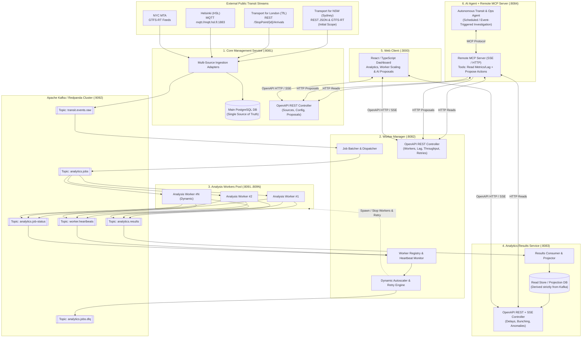

# CEBP Project — Agent Context, General Scope & Current Resources

> **Document Purpose**: This is the authoritative onboarding and coordination document for all AI agents and developers working on the **CEBP (Concurrent and Event-Based Programming)** project: **A Distributed Public Transit Data Analytics Platform with Dynamic Worker Management**.

---

## 1. Current Workspace & Repository Status

### 1.1 Existing Files & Resources
| Resource Path | Description | Current Status |
| :--- | :--- | :--- |
| `../CEBP-w7 tldr.pdf` | Official architectural specification: *"A Distributed Data Analytics Platform with Dynamic Worker Management"* defining the 6 components, Kafka event flow, and Worker Manager responsibilities. | Read & analyzed |
| `../project submission requirements.txt` | Official course grading requirements: Java platform, >=3 distinct remote components, OpenAPI documentation, Kafka/event streaming, Single Source of Truth (SSOT) database, Docker containerization, Remote MCP Server (>=3 tools: read + propose), and an autonomous Agentic AI workflow. | Read & analyzed |
| `./README.md` | Root README of the Git repository (`https://github.com/Snowman23/CEBP.git`, branch `main`). | Updated with architecture & links |
| `./AGENTS.md` | This document — general scope, data source specifications, architecture, and status tracker for multi-agent collaboration. | Active |
| `./docs/IMPLEMENTATION_PLAN.md` | End-to-end phased implementation plan, directory structure, API/Kafka schemas, and verification checklist. | Active |

### 1.2 Implementation Status Summary
- **Current State**: **Phase 1 (Day-1 Shared Foundation) is 100% implemented and verified (`mvn clean install` passing across all 7 modules).**
- **Ready for Parallel 4-Way Team Development**:
  - `common-events` (4 Kafka event records, 4 topic constants, shared REST DTOs, and `SampleTransitFixtures`) is locked and installed.
  - `docker-compose.yml` (Redpanda Kafka `:9092`, Redpanda Console `:8080`, PostgreSQL `core_db` `:5432`, plus full microservice profiles) is ready.
  - All 5 Spring Boot microservices (`core-management-service` `:8081`, `worker-manager-service` `:8082`, `analysis-worker` `:8091`, `analytics-results-service` `:8083`, `mcp-agent-service` `:8084`) and `web-client` (`:3000`) have working starter shells, OpenAPI `/swagger-ui.html`, and standalone `/api/v1/dev/...` simulators.

---

## 2. General Scope & Academic Requirements Checklist

Every agent writing code for this repository **must** enforce the following constraints from `project submission requirements.txt` and `CEBP-w7 tldr.pdf`:

1. **Java Platform**: All backend services (`core-management-service`, `worker-manager-service`, `analysis-worker`, `analytics-results-service`, `mcp-agent-service`) must be built on the **Java platform** (Java 21 LTS + Spring Boot 3.4+, utilizing Virtual Threads and concurrent/event-driven idioms).
2. **6 Distinct Components Communicating Remotely** (exceeds the minimum 3 required):
   - **Core Management Service**: Owns the main database (SSOT), ingests live public transit streams, and publishes raw business events to Kafka.
   - **Worker Manager**: Tracks workers, monitors heartbeats, tracks waiting tasks & throughput/latency, detects dead workers, manages dynamic scaling, and triggers retries for failed tasks.
   - **Analysis Workers**: Horizontally scalable worker nodes that consume analytical jobs from Kafka, compute transit analytics (delays, bunching, speed anomalies), and publish results to Kafka.
   - **Analytics Results Service**: Consumes analytical results from Kafka, stores read-optimized projections in its own store, and exposes them via HTTP APIs.
   - **Web Client**: Dashboard displaying real-time transit analytics, worker cluster health, Kafka lag/throughput, and AI agent proposals.
   - **AI Agent + Remote MCP Server**: Exposes a remotely accessible MCP server (`SSE` / `Streamable HTTP`) with >=3 tools and runs an autonomous agentic loop that investigates operational/transit data and proposes concrete improvements.
3. **Event Streaming (Maximum Grade Requirement)**: Use **Apache Kafka** (or Redpanda Kafka-compatible broker) as the central nervous system for event distribution, job scheduling, worker heartbeats, and result aggregation.
4. **Single Source of Truth (SSOT)**:
   - **ONLY `core-management-service` writes to the Main Database (`core_db`)**.
   - All other services (`worker-manager-service`, `analytics-results-service`) build their local views/projections strictly from Kafka events, message queues, or remote API calls.
5. **OpenAPI Documentation**:
   - **All HTTP APIs (except the MCP protocol endpoint)** must be documented following **OpenAPI 3.0/3.1 standards** (`springdoc-openapi-starter-webmvc-ui` exposing `/v3/api-docs` and `/swagger-ui.html` on every HTTP microservice).
6. **Containerization**: Full system deployment via **Docker & Docker Compose** (`docker-compose.yml`).
7. **Agentic AI & Remote MCP Server**:
   - Remote MCP Server with **at least 3 tools** (including at least 1 read tool and 1 change-proposal tool).
   - Autonomous agentic component performing a concrete operational task (NOT a generic chatbot): periodically or event-driven investigating worker lag, failed tasks, and public transit anomalies to propose worker scaling, event replays, or transit schedule/alert mitigations.

---

## 3. Data Sources & Ingestion Scope

The system's real-time operational data comes from the **Transportation / Public Transit** category of [`conduktor/public-streaming-api`](https://github.com/conduktor/public-streaming-api#development--testing), with **Transport for NSW (TfNSW) Open Data** as our **Initial Primary Scope** and a modular `TransitSourceConnector` architecture supporting TfL, HSL, and MTA.

### 3.1 Initial Scope (Primary): Transport for NSW (TfNSW) Open Data — Sydney, Australia
- **Portal**: [https://opendata.transport.nsw.gov.au/](https://opendata.transport.nsw.gov.au/)
- **API Basics Specification**: [https://opendata.transport.nsw.gov.au/developers/api-basics](https://opendata.transport.nsw.gov.au/developers/api-basics)
- **Server & Base URL**:
  - Host: `api.transport.nsw.gov.au` (HTTPS over port `443`)
  - Base URL: `https://api.transport.nsw.gov.au/v1/` (and `v2` for specific upgraded GTFS-R feeds)
- **Authentication**:
  - Requires an API Key passed in the HTTP `Authorization` header:
    ```http
    Authorization: apikey <TFNSW_API_KEY>
    ```
  - Configured via environment variable `TFNSW_API_KEY`.
- **Target Endpoints for Initial Scope**:
  1. **Trip Planner / Departure Board & Stop Finder APIs (JSON)**:
     - `GET /v1/tp/stop_finder` — Lookup stop IDs (e.g., Central Station, Circular Quay, Parramatta).
     - `GET /v1/tp/departure_mon` — Real-time departure monitor returning JSON stop events with scheduled vs. estimated departure times, route numbers, transport modes, and service alerts.
  2. **GTFS-Realtime Vehicle Positions & Trip Updates (Protobuf / `.pb`)**:
     - `GET /v1/gtfs/realtime/buses` (Trip updates & delay predictions)
     - `GET /v1/gtfs/vehiclepos/buses` (Real-time GPS coordinates, bearing, speed)
     - `GET /v1/gtfs/alerts/all` (Active network disruptions and alerts)
- **Resilience / Offline Grading Mode**:
  - Because `TFNSW_API_KEY` requires developer portal registration and has rate quotas, `core-management-service` **must include a deterministic `TfNswReplayAndMockConnector`** that replays realistic recorded Sydney transit JSON/GTFS payloads when `TFNSW_API_KEY` is unset or when burst stress-testing is triggered.

### 3.2 Secondary / Multi-Region Connectors (Plug-and-Play Expansion)

To demonstrate high-throughput multi-source streaming and test dynamic worker scaling under heavy load, `core-management-service` also integrates the remaining 3 transit feeds specified in project scope:

#### A. Transport for London (TfL) Unified API — London, UK
- **Docs**: [https://tfl.gov.uk/info-for/open-data-users/our-open-data](https://tfl.gov.uk/info-for/open-data-users/our-open-data)
- **Endpoint**: `GET https://api.tfl.gov.uk/StopPoint/{id}/Arrivals` (e.g., `490000015K`, `940GZZLUOXC` Oxford Circus)
- **Auth**: **No API key required** for standard polling (optional `app_key` for high rate limits).
- **Format**: JSON array of `Tfl.Api.Presentation.Entities.Prediction` objects containing:
  - `vehicleId`, `naptanId`, `stationName`, `lineId`, `lineName`, `modeName` (`tube`, `bus`, `dlr`, `elizabeth-line`), `timeToStation` (seconds), `expectedArrival` (ISO-8601), `towards`, `currentLocation`.

#### B. Helsinki Regional Transport (HSL) — Helsinki, Finland
- **Docs**: [https://digitransit.fi/en/developers/](https://digitransit.fi/en/developers/)
- **Broker URL**: `mqtt://mqtt.hsl.fi:1883` (Eclipse Paho / HiveMQ MQTT Client in Java)
- **Auth**: **No API key required** (Public anonymous MQTT subscription).
- **Topic Subscription**:
  - `/hfp/v2/journey/ongoing/vp/+/#` (or filtered by mode, e.g., `/hfp/v2/journey/ongoing/vp/bus/#`, `/hfp/v2/journey/ongoing/vp/tram/#`)
- **Format**: High-frequency (1 Hz) compact JSON payload with root key `"VP"`:
  - `desi` (route number), `veh` (vehicle ID), `tst` (ISO timestamp), `lat`, `long`, `spd` (m/s), `hdg` (heading), `dl` (**delay in seconds** — negative = early, positive = late), `stop`, `oday`.
- **Why HSL is strategic for CEBP**: Provides continuous, real-time, high-frequency streaming out of the box without API keys, allowing us to flood the Kafka pipeline with real messages at any time to demonstrate **Worker Manager dynamic scaling**!

#### C. MTA Real-Time Data Feeds — New York City, USA
- **Docs**: [https://new.mta.info/developers](https://new.mta.info/developers)
- **Endpoints**:
  - Subway GTFS-RT (Keyless): `https://api-endpoint.mta.info/Dataservice/mtagtfsfeeds/nyct%2Fgtfs-ace`, `nyct%2Fgtfs`, `nyct%2Fgtfs-bdfm`, `camsys%2Fsubway-alerts`
  - Bus Time API: Requires `MTA_API_KEY` query parameter.
- **Format**: GTFS-Realtime Protocol Buffers (`com.google.transit:gtfs-realtime-bindings`).

---

## 4. Canonical Event Schema (`NormalizedTransitEvent`)

Regardless of whether an event originates from **TfNSW (Sydney)**, **TfL (London)**, **HSL (Helsinki)**, or **MTA (NYC)**, `core-management-service` normalizes it into a single canonical schema before persisting to `core_db` and publishing to Kafka (`transit.events.raw`):

```json
{
  "eventId": "uuid-v4",
  "source": "TFNSW | TFL | HSL | MTA | SIMULATOR",
  "ingestedAt": "2026-11-15T15:40:00Z",
  "eventTimestamp": "2026-11-15T15:39:58Z",
  "transportMode": "TRAIN | METRO | BUS | TRAM | FERRY",
  "agencyId": "SydneyTrains",
  "routeId": "T1",
  "routeName": "T1 North Shore & Western Line",
  "directionId": "1",
  "vehicleId": "A42",
  "stopId": "200060",
  "stopName": "Central Station",
  "latitude": -33.8830,
  "longitude": 151.2070,
  "speedMps": 14.2,
  "heading": 180,
  "delaySeconds": 185,
  "timeToStationSeconds": 120,
  "expectedArrival": "2026-11-15T15:41:58Z",
  "occupancyStatus": "MANY_SEATS_AVAILABLE",
  "rawAttributes": {
    "platformName": "Platform 16",
    "towards": "Berowra"
  }
}
```

---

## 5. System Architecture & Kafka Event Flow (Per PDF Spec)



---

## 6. Architectural Simplifications (High Grade, Low Friction)

To maximize reliability during development and the live lab demonstration while staying 100% within the PDF and grading specs:
1. **Virtual Worker Pool (`analysis-worker`)**: Instead of slow/fragile Docker-in-Docker container spawning, `analysis-worker` hosts a **Dynamic Virtual Worker Pool** (using Java 21 Virtual Threads & isolated Kafka consumer instances `worker-1..N`). Scaling up/down via `POST /api/v1/worker-pool/scale` or killing a specific worker (`POST /api/v1/worker-pool/{id}/kill`) takes `<100ms` and works identically on Windows, macOS, and Linux.
2. **JSON-First Data Sources**:
   - **Initial Scope (`TfNSW` Sydney)**: Uses the JSON Trip Planner Departure Monitor (`/v1/tp/departure_mon`) + `TfNswReplayFallback` first (avoiding complex binary GTFS-RT Protobuf setup until needed).
   - **Keyless Live Streams (`TfL` REST JSON + `HSL` MQTT JSON)**: Both return pure UTF-8 JSON without API keys, giving us continuous real-time traffic out-of-the-box.
3. **Strict & Simple Single Source of Truth (SSOT)**:
   - Only `core-management-service` uses the PostgreSQL container (`core_db`).
   - `worker-manager-service` and `analytics-results-service` use lightweight in-memory / H2 read projections rebuilt strictly from Kafka events.
4. **4 Consolidated Kafka Topics**:
   - `transit.events.raw` (Core -> Worker Manager)
   - `analytics.jobs` (Worker Manager -> Analysis Workers)
   - `worker.telemetry` (Analysis Workers -> Worker Manager: unified heartbeats + job status/latency)
   - `analytics.results` (Analysis Workers -> Analytics Results Service)

---

## 7. 4-Way Team Split (Parallel & Independent Workstreams)

Each team member owns isolated Maven modules / directories and communicates exclusively through the shared `common-events` DTOs and documented OpenAPI / Kafka contracts:

| Member | Owned Modules & Ports | Primary Responsibilities | Independent Testing Strategy |
| :--- | :--- | :--- | :--- |
| **Member 1**<br/>*(Ingestion & SSOT)* | `core-management-service` (`:8081`) + `core_db` (Postgres) | • Main DB schema (SSOT)<br/>• **TfNSW (Sydney)** JSON connector + replay fallback<br/>• **TfL** & **HSL MQTT** live connectors + Burst Generator<br/>• Publish `transit.events.raw`<br/>• Proposals CRUD API (`/api/v1/proposals`) | Run with Redpanda + Postgres; trigger `/api/v1/ingest/simulate-burst` and verify messages in Kafka UI. |
| **Member 2**<br/>*(Worker Manager)* | `worker-manager-service` (`:8082`) | • Consume `transit.events.raw` & batch into `analytics.jobs`<br/>• Track workers & 5s heartbeats from `worker.telemetry`<br/>• Track waiting tasks, p50/p95/p99 latency & throughput<br/>• Detect dead workers (>15s), trigger retries (max 3) & dynamic scaling | Built-in test generator publishes mock raw events & worker telemetry to verify scaling & retry logic standalone. |
| **Member 3**<br/>*(Workers & Results)* | `analysis-worker` (`:8091`) + `analytics-results-service` (`:8083`) | • Dynamic Virtual Worker Pool (spawn/kill worker instances, emit 5s heartbeats)<br/>• Delay, Bunching & Speed Anomaly processors<br/>• Publish `analytics.results`<br/>• Read projection store & OpenAPI + SSE APIs (`:8083`) | Publish fixture `AnalyticalJobMessage` to `analytics.jobs` and verify computed results on `:8083/swagger-ui.html`. |
| **Member 4**<br/>*(MCP, AI Agent & UI)* | `mcp-agent-service` (`:8084`) + `web-client` (`:3000`) | • **Remote MCP Server** (`/mcp/sse`) with Read & Propose tools<br/>• **Autonomous Ops AI Agent** (Gemini Free Tier + deterministic fallback)<br/>• **React + TS Dashboard** (Transit analytics, Worker cluster control, AI Proposals approval) | Develop against mock OpenAPI JSON fixtures first, then switch base URLs to `:8081`, `:8082`, `:8083`. |

---

## 8. Agent Coordination Rules & Conventions

When multiple agents or developers work on this repository:
1. **Work inside `CEBP/`**: All application code, `pom.xml`, and `docker-compose.yml` belong inside the Git repository directory `CEBP/`.
2. **Respect Single Source of Truth**: Never connect `worker-manager-service`, `analysis-worker`, or `analytics-results-service` directly to `core_db`. Only `core-management-service` connects to `core_db`.
3. **Maintain OpenAPI Annotations**: Every `@RestController` in every service (except the MCP protocol transport endpoint) must include `@Tag` and `@Operation` annotations from `io.swagger.v3.oas.annotations` so `/swagger-ui.html` and `/v3/api-docs` are always complete.
4. **Update Status**: Whenever a module or phase in `docs/IMPLEMENTATION_PLAN.md` is completed, update its status checkbox `[x]` in `docs/IMPLEMENTATION_PLAN.md` and `AGENTS.md`.
